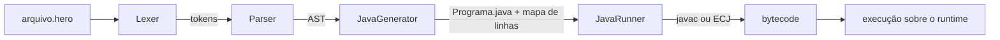

# Como funciona

A HeroScript é um **transpiler**: traduz `.hero` para Java e deixa o compilador Java fazer o resto.

| Etapa | Arquivo | Responsabilidade |
|---|---|---|
| [Lexer](lexer.md) | `compiler/Lexer.java` | texto → tokens com linha e coluna |
| [Parser](parser.md) | `compiler/Parser.java`, `Ast.java` | tokens → árvore sintática |
| [Gerador](gerador.md) | `compiler/JavaGenerator.java` | validação semântica + Java gerado |
| Execução | `compiler/JavaRunner.java` | compila com javac ou ECJ e chama o `main` sem encerrar a JVM |
| [Runtime](runtime.md) | `runtime/*.java` | as regras: energia, recarga, escudos, formas, segredos, squads |
| [Playground](playground.md) | `playground/Playground.java` + `playground/*` | o mesmo pipeline no navegador (WebAssembly) |

## Decisões de design

| Decisão | Escolha | Por quê |
|---|---|---|
| Tipo de implementação | transpiler para Java | mostra lexer, parser e gerador sem precisar de máquina virtual própria |
| Linguagem do compilador | Java 17, sem Maven/Gradle | só `javac` é necessário |
| O que vem do Java | tipos, expressões, controle de fluxo | já funcionam bem; reinventar não traria vantagem |
| Onde ficam as regras | runtime em Java comum | código gerado curto e regras fáceis de testar |

!!! tip "Tutorial completo"
    O arquivo [`PROMPT.md`](https://github.com/YukidaK/heroscript/blob/main/PROMPT.md) do repositório é um
    tutorial passo a passo de como construir a linguagem do zero e termina com um prompt para uma IA recriar o
    projeto.
