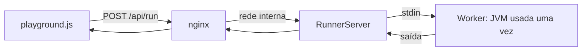
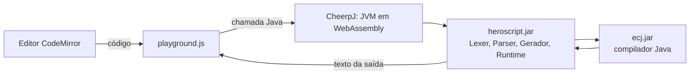

# Playground (WebAssembly)

O [playground](../playground/index.html) executa HeroScript **com o mesmo compilador** da linha de comando — nada
de reimplementação em JavaScript. Há dois lugares onde ele pode rodar:

| | No servidor | No navegador |
|---|---|---|
| Quando | sempre que `/api/health` responde | se o servidor não responder ou falhar |
| Pronto para usar | ao abrir a página | depois de ~40 s de preparo |
| Cada execução | 0,5 a 2 s | 2 a 5 s |
| Compilador Java | `javac` | ECJ |
| Onde | container `runner` | JVM em WebAssembly (CheerpJ) |

O `playground.js` tenta o servidor primeiro. Se uma chamada falhar (rede, runner fora do ar, ocupado, limite de
requisições), ele inicia o CheerpJ naquele momento, refaz a chamada no navegador e volta a testar o servidor um
minuto depois. O rodapé da página diz onde o programa está rodando.

## Execução no servidor



`heroscript.server.RunnerServer` atende `POST /api/run`, `/api/java`, `/api/tokens` e `/api/diagnostics`, com o
programa no corpo. Ele nunca executa o programa no próprio processo: entrega a um `Worker`, uma JVM filha que
atende **um único programa** e termina. Para não pagar a partida da JVM a cada clique, o servidor mantém JVMs já
iniciadas e com o `javac` carregado, à espera; cada uma é reposta depois de usada.

Um programa HeroScript contém Java embutido, ou seja, **código arbitrário de quem visita o site**. As defesas
ficam em duas camadas:

| Camada | O que impõe |
|---|---|
| `RunnerServer` | 10 s por execução (processo morto), 64 KB de entrada, 256 KB de saída, 128 MB de heap por JVM, 2 execuções simultâneas (as demais recebem 503) |
| container (`deploy/docker-compose.yml`) | rede `internal` (sem internet, sem LAN), disco somente leitura, `/tmp` em memória, usuário `nobody`, nenhuma capability, limite de processos, memória e CPU |
| nginx | 3 requisições/s por visitante, corpo de até 64 KB |

!!! warning "O que esse isolamento não cobre"
    - Container não é máquina virtual: uma falha de escape do Docker ou do kernel alcançaria o host.
    - Execuções simultâneas usam o mesmo usuário no mesmo container. Um programa malicioso pode ler o código de
      outra execução em andamento, ou derrubar o runner — o Docker o reinicia e, enquanto isso, o playground roda no
      navegador.
    - O runner não deve receber segredos por variável de ambiente nem volumes: tudo o que ele enxerga, o visitante
      enxerga.

A mensagem de um erro no Java embutido muda conforme o lugar (`javac` no servidor, ECJ no navegador); a linha é a
mesma.

## Execução no navegador



## Peças

| Peça | Papel |
|---|---|
| [CheerpJ](https://cheerpj.com) 4.3 | JVM compilada para WebAssembly, carregada do CDN da Leaning Technologies |
| `heroscript.jar` | compilador + runtime, compilados com `--release 17` |
| `ecj.jar` | Eclipse Compiler for Java 3.38 — compilador Java escrito em Java, substitui o `javac` |
| `jdk17-base.jar` | API pública do `java.base` do Java 17, extraída do `ct.sym` do JDK por `scripts/make_jdk_stub.py` |
| `Playground.java` | ponte com métodos estáticos `run`, `java`, `tokens` e `diagnostics` que devolvem texto |
| `playground.js` | chama o servidor; sem ele, inicia o CheerpJ, carrega os jars em modo biblioteca e chama a ponte |
| `playground.css` | visual do playground; cores e fontes vêm de `docs/assets/comic-tokens.css`, o mesmo arquivo usado pela documentação |

```js
await cheerpjInit({
  version: 17,
  javaProperties: ["java.io.tmpdir=/files", "heroscript.platform=/app/.../jdk17-base.jar"],
});
const lib = await cheerpjRunLibrary("/app/.../heroscript.jar:/app/.../ecj.jar");
const Playground = await lib.heroscript.playground.Playground;
const saida = await Playground.run(codigo);
```

## Detalhes importantes

- **Sem `System.exit`**: `Playground.run` redireciona `System.out` para um buffer e o `JavaRunner` troca o
  encerramento por um sinal interno, então a JVM continua viva entre execuções.
- **Classes do JDK**: fora do navegador o ECJ lê as classes do Java pelo sistema de módulos (`jrt:/`), que o
  CheerpJ não oferece. Por isso o `JavaRunner` entrega ao ECJ o `jdk17-base.jar` como `PLATFORM_CLASS_PATH` e
  esvazia `SYSTEM_MODULES`. Isso só funciona com o gerenciador de arquivos padrão do ECJ, sem embrulho: com um
  `ForwardingJavaFileManager` o ECJ ignora essas configurações e volta a procurar o `jrt:/`.
- **Arquivos temporários**: o ECJ só compila fontes que existem em disco; no navegador o `.java` e os `.class`
  vão para `/files`, o sistema de arquivos virtual do CheerpJ.
- **Bytecode Java 17**: o CheerpJ executa no máximo Java 17, mas o ECJ gera por padrão a versão mais nova que
  conhece. O `JavaRunner` passa `-source 17 -target 17` ao ECJ (e `--release 17` ao `javac`). Sem isso a classe
  gerada é recusada com `UnsupportedClassVersionError`.
- **Nenhum erro pode escapar**: `Playground.run` captura também `Error`. Uma exceção que saísse da chamada deixaria
  a promessa do JavaScript pendente para sempre, e a página pareceria travada.
- **Aquecimento**: a primeira compilação no navegador leva cerca de 40 s, porque o ECJ ainda está sendo
  otimizado pela JVM. Um dos métodos do parser do ECJ é grande demais para o JIT do CheerpJ e roda interpretado. Por
  isso, ao iniciar o CheerpJ, a página compila um programa mínimo e mostra um cronômetro; depois disso cada execução
  leva de 2 a 5 s.
- **Diagnóstico**: com `heroscript.debug=true` (ligado no playground), o `JavaRunner` mostra as etapas e os tempos no
  console do navegador (F12).
- **Compartilhar**: o botão gera um link com o código em `#code=...`; `?example=nome` abre um exemplo.

## spiderSense no editor

`Playground.diagnostics` devolve os [diagnósticos](../linguagem/spider-sense.md) em JSON. O `playground.js` o chama
700 ms depois da última tecla e desenha uma aranha na margem de cada linha com erro (vermelha) ou aviso (amarela).

- **Compila, mas não executa**: a análise passa pelo mesmo caminho do `run` até o compilador Java e para antes de
  carregar a classe. No servidor é `POST /api/diagnostics`.
- **Uma chamada por vez**: a JVM do CheerpJ atende uma chamada de cada vez, e `System.out` e a `Arena` são globais.
  Por isso a análise nunca roda junto com uma execução (a mesma regra vale no modo servidor). Ela **não desabilita os botões**: se você clicar em
  Executar durante uma análise, a execução espera a análise terminar.
- **Resultados antigos são descartados**: cada edição incrementa um contador; uma análise que termina depois de uma
  nova edição não desenha nada e é reagendada.

## Testando o caminho do navegador

Os testes automáticos usam o `javac`. Para exercitar localmente o compilador do playground:

```bash
scripts/build_playground.sh
java -Dheroscript.compiler=ecj -Dheroscript.platform=build/playground/jdk17-base.jar \
     -cp build/classes:build/vendor/ecj-3.38.0.jar heroscript.compiler.Main run examples/batcave.hero
```

A saída deve ser igual à de `tests/expected/`, exceto pelo texto dos erros de Java embutido (a mensagem vem do ECJ).
Isso ainda não testa o CheerpJ: recursos do runtime que dependem da JVM — como o `StackWalker` usado pela
[batcave](../linguagem/batcave.md) — só são confirmados abrindo o playground no navegador.

## Montando localmente

```bash
scripts/build_playground.sh          # build/playground: jars + examples.json + página
python3 scripts/serve.py build 8000  # http://localhost:8000/playground/
```

O servidor precisa suportar *Range requests* (o `scripts/serve.py` suporta; `python -m http.server` não). Servido
assim não existe `/api/`, então o playground roda no navegador.

Para testar com o runner, use a stack local descrita em
[`deploy/README.md`](https://github.com/YukidaK/heroscript/blob/main/deploy/README.md#rodar-local): nginx e runner
em containers, acessíveis só pela própria máquina.
